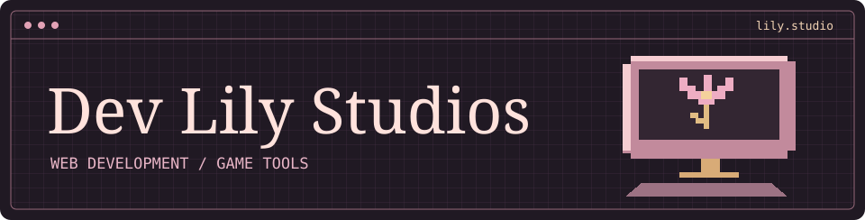

[Studio portfolio](https://bit.ly/4Asrm6z) · [Explore The Adventure Log](https://www.adventurehubrs.site)

## Inside the studio

I’m Lily, the developer behind Dev Lily Studios. I build interactive websites, game plugins, and tools for gaming communities. Some days that means figuring out how a pixel-art scene should react to a cursor. Other days it means getting a group of RuneScape players into the same minigame.

🌱 How one question became a project

I wanted to open RuneScape after a break and remember what I was doing. That became **Where Was I?**. With **The Adventure Log**, I’m working on the other half of that question: what sounds fun to do next, and who wants to go?

## Selected studio projects

| Project | What you can do |
| --- | --- |
| [The Adventure Log](https://www.adventurehubrs.site) | Explore the OSRS and RS3 activity maps and pick a weekly skill, boss, or solo challenge. |
| Dev Lily Portfolio | Explore my work through a retro-computer interface with an interactive pixel-art scene. |
| Where Was I? | Pick up an RS3 session with a reminder of what you were doing before you logged out. |
| Minigame Lobby | Find other players who want to run the same minigame. |
| Spark | Find studio projects and announcements inside the Dev Lily Studios Discord. |

## Studio toolkit

<code>✿  Dev Lily Studios  ·  See you in Gielinor  ✿</code>

